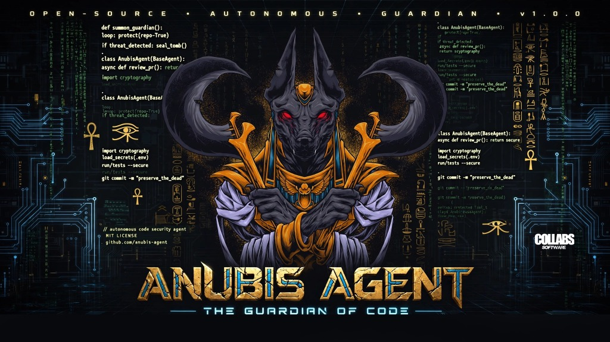

# 𓂀 ANUBIS AGENT — THE GUARDIAN OF CODE (`anubis-agent-gui`)

  

**Anubis Agent GUI** is the cross-platform Go + Wails v2 native desktop graphical user interface for Windows, Linux, and macOS (Apple Silicon M1/M2/M3/M4) featuring the Egyptian Gold (`#FFD700`) + Lapis Blue (`#1E90FF`) + Deep Midnight (`#1A1A2E`) dark theme.

## Features
- **Left Sidebar**: Chats, Verified Tomb Skills (`REA v6.8.0`, `Kali + ChainKeys OPSEC`, `Universal Media Downloader`, `Self-Healing Verifier`), and Du'at Mode schedule.
- **Center Pane**: Interactive Bicameral Chat + Agent Canvas.
- **Right Sidebar**: Live **Weighing of the Heart** gauge (`Heart Risk 0-100` vs `Feather of Ma'at 42`) and **Holographic `.synapse` Tensor Viewer** (`<0.25ms` recall).
- **Top Bar**: Model Router (`collabs-14b:latest`, `collabs-7b:latest`, `deepthink`, `q8_0`, Custom GGUF/MLX, and Auto Local-first / Cloud fallback).
